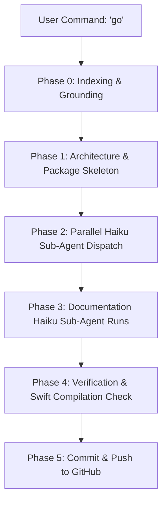

# CLAUDE CODE ORCHESTRATION HARNESS: ADAPTIVE TIMELINE NATIVE IOS CONVERSION

> **Execution Directive**: When this file is provided to Claude Code and the user says `"go"` (or references this document), immediately begin **Phase 0: Indexing & Grounding**. Do not generate placeholders or pseudo-code. Execute the complete orchestrator-worker pipeline through Opus and Haiku sub-agents as specified below.

---

<system_architecture>
  <orchestrator_model>Claude 3.5 / 3.7 / Opus (High Reasoning, Planning, Synthesis)</orchestrator_model>
  <subagent_model>Claude 3.5 / Haiku (High Throughput, Low Latency, Isolated Task Execution)</subagent_model>
  <target_platform>iOS 17.0+ (Swift 6, SwiftUI, Metal, CoreHaptics, Swift Package Manager)</target_platform>
  <design_pattern>Deep Modular Architecture (Matt Pocock / John Ousterhout Seam Principles)</design_pattern>
</system_architecture>

---

## 1. Master Orchestrator Role & Operating Principles

You are the **Lead System Architect & Orchestrator (Opus)**. You govern system decomposition, domain boundaries, sub-agent dispatching, and integration verification. You do not pollute your primary context window with bulky file edits or repetitive implementation passes. Instead, you orchestrate specialized **Haiku Sub-Agents** running in isolated context windows with strictly bounded input/output contracts.

### Operating Rules for the Orchestrator
1. **Context Isolation**: Each sub-agent receives only the exact module specification, interface types, and constraints required for its task. Never pass full repository history to a worker.
2. **Indexing Before Planning**: Never write an implementation plan before completing **Phase 0: Repository Indexing**. Ground all design decisions in the existing web prototype (`index.html`, `plans/`, and assets).
3. **Deep Modules (Small Interfaces, Deep Logic)**: Structure the codebase into deep, decoupled packages. A module must expose a narrow, clean protocol interface while encapsulating rich state, physics, or rendering algorithms internally.
4. **Dedicated Documentation Sub-Agent**: Every module directory must be accompanied by an `AGENT.md` file produced by a specialized Documentation Haiku agent.
5. **Zero Em-Dashes**: Follow the global repository standard. Use only hyphens `-` for punctuation and lists. Never emit Unicode em-dashes or en-dashes.
6. **Matt Pocock Skill Suite**: Proactively activate and invoke `/domain-modeling`, `/codebase-design`, `/tdd`, and `/code-review` across the workflow.

---

## 2. Phase 0: Grounding & Indexing Protocol (Mandatory First Step)

Before declaring tickets or invoking worker agents, the Orchestrator must inspect the primary source prototype files in the current repository:

```bash
# Required Indexing Reads
1. index.html (Inspect clock dial SVG bezier math, 5 retention screens, glass CSS tokens, motion blur filters)
2. UI_UX_PSYCHOLOGICAL_RETENTION_EVALUATION.md (Understand psychological retention models)
3. plans/*.md (Inspect timing calibrations, spring parameters, tab transitions)
4. assets/ (Inspect fonts, Phosphor icons, and wallpaper assets)
```

### Critical Specifications to Extract During Indexing
- **Clock Dial Cubic Bezier Formula**:
  `M 50 140 C 91.4 231.4, 135 328.4, 123.6 420 C 126.1 499.5, 108.7 575.3, 81 652 C 83.4 679.5, 51.3 709.5, 41 738`
  Total curve length approximately 627 points.
- **Active Node Anchor**: Centered on curve at `(84.0, 217.7)` representing the current time anchor (~3:40 PM).
- **5 Psychological Retention States**:
  1. *Triage Horizon*: Inflow management, calm visual priority.
  2. *Active Focus Session*: Deep work flow, countdown timer, ambient periphery.
  3. *Adaptive Reallocation*: Graceful time-overrun handling without guilt or panic.
  4. *Silent Focus Room*: Social accountability with presence dots and zero-friction join.
  5. *Peak-End Climax*: Celebration, completion checkmarks, post-effort closure.
  6. *Plan Overview*: Inward clock rotation (`13.5deg`), horizon sliver, background parallax drift.
- **Liquid Glass Material**: Apple-spec specular rim lighting, subtle drop shadow, translucent gradient wash, backdrop blur.
- **Velocity-Coupled Motion Blur**: Directional blur modulated along half-sine velocity envelope (`Math.sin(progress * Math.PI)`), peaking at mid-velocity and dissolving to zero prior to settling.

---

## 3. Modular Target Architecture (Swift Package Structure)

The iOS demo must not be a monolithic view file. It must be organized into decoupled, testable Swift modules under `AdaptiveTimeline/`:

```
AdaptiveTimeline/
├── Package.swift
├── Sources/
│   ├── TimelineDomain/           # Pure Swift models, state machine, psychological state transitions
│   │   └── AGENT.md
│   ├── TimelineGeometry/         # Exact cubic bezier evaluation, arc length parameterization, spoke projection
│   │   └── AGENT.md
│   ├── TimelinePhysics/          # Fluid springs, rubber-band calculations, Command Orb morphology
│   │   └── AGENT.md
│   ├── TimelineMotion/           # Metal directional blur shaders, velocity envelope calculators
│   │   └── AGENT.md
│   ├── TimelineAudio/            # CoreHaptics patterns and AVAudioEngine synthesized feedback
│   │   └── AGENT.md
│   ├── TimelineUI/               # Liquid glass components, curved dial canvas, status card presentations
│   │   └── AGENT.md
│   └── TimelineApp/              # Demo app container, companion diagnostic sidebar for iPad/Mac/iPhone
│       └── AGENT.md
└── Tests/
    ├── TimelineDomainTests/
    ├── TimelineGeometryTests/
    └── TimelinePhysicsTests/
```

---

## 4. Sub-Agent Delegation Specifications (Haiku Workers)

The Orchestrator will spawn and coordinate the following specialized Haiku sub-agents:

### Worker 1: Domain & State Machine Specialist (Haiku)
- **Role**: Pure Swift Domain Modeling (`TimelineDomain`).
- **Input Contract**: Screen specs from `index.html` lines 2080-2220 and `UI_UX_PSYCHOLOGICAL_RETENTION_EVALUATION.md`.
- **Output Deliverables**:
  - `TimelineState.swift`: Enum with cases `.triage`, `.focus`, `.overrun`, `.focusRoom`, `.allSet`, `.plan`.
  - `TimelineSession.swift`: Value model with duration, tasks, progress, presence indicators.
  - `TimelineStateMachine.swift`: Unidirectional state flow with validation and transition events.
- **Skill Activation**: `/domain-modeling` (Ubiquitous Language, zero framework coupling).

### Worker 2: Curve Geometry & Math Specialist (Haiku)
- **Role**: Parametric Bezier Evaluation (`TimelineGeometry`).
- **Input Contract**: SVG path data `d="M 50 140 C 91.4 231.4, 135 328.4, 123.6 420 C 126.1 499.5, 108.7 575.3, 81 652 C 83.4 679.5, 51.3 709.5, 41 738"`.
- **Output Deliverables**:
  - `CubicBezierCurve.swift`: De Casteljau subdivision, length calculation via numerical integration.
  - `ArcProjection.swift`: Point-on-curve mapping, perpendicular normal angles for spoke tick marks and hour markers.
  - `TimelineSegmentSlice.swift`: Start/end stroke trim offsets for active task intervals (Calc Review, Free Time, Practice).

### Worker 3: Physics & Gesture Engine Specialist (Haiku)
- **Role**: Direct Manipulation & Morphing Springs (`TimelinePhysics`).
- **Input Contract**: Fluid gesture code from `index.html` lines 2570-2790.
- **Output Deliverables**:
  - `SpringSolver.swift`: RK4 or analytical second-order spring dynamics with stiffness 320, damping 30.
  - `RubberBanding.swift`: Apple standard dimension rubber-band formula for bounds resistance.
  - `OrbMorphology.swift`: Morphing state machine transitioning between resting capsule (54x54), expanded text input bar (full-width x 56), and voice record pill.

### Worker 4: Motion Blur & Metal Shader Specialist (Haiku)
- **Role**: Anisotropic Velocity-Coupled Motion Blur (`TimelineMotion`).
- **Input Contract**: Motion blur half-sine envelope specification (`triggerOrbMotionStreak`, `triggerArcMotionBlur`).
- **Output Deliverables**:
  - `DirectionalMotionBlur.metal`: Metal kernel applying anisotropic blur along arbitrary 2D velocity vectors.
  - `MotionBlurModifier.swift`: SwiftUI view modifier binding velocity magnitude and direction to the Metal shader pass.
  - `VelocityEnvelope.swift`: Half-sine pulse calculator ensuring blur gracefully reaches zero prior to spring settlement to avoid ending pops.

### Worker 5: Audio & Haptic Feedback Specialist (Haiku)
- **Role**: Tactile & Acoustic Response (`TimelineAudio`).
- **Input Contract**: Audio cues in `index.html` (tap: exponential pitch drop 340Hz to 140Hz; check: 480Hz to 840Hz; allset: arpeggio 523Hz, 659Hz, 784Hz, 1046Hz).
- **Output Deliverables**:
  - `HapticManager.swift`: CoreHaptics transient and continuous tap feedback.
  - `AudioFeedbackEngine.swift`: Lightweight synthesis engine matching the web audio frequencies.

### Worker 6: UI Presentation & Component Specialist (Haiku)
- **Role**: SwiftUI Interface & Diagnostic Companion (`TimelineUI`, `TimelineApp`).
- **Input Contract**: HTML layouts, glass material tokens, diagnostic companion sidebar with motion blur slider and wallpaper selector.
- **Output Deliverables**:
  - `LiquidGlassView.swift`: Translucent material with specular rim stroke and drop shadow.
  - `CurvedTimelineDialView.swift`: Canvas/Path rendering of the arc curve, radiating spokes, and active purple node aura.
  - `CommandOrbView.swift`: Interactive morphing orb with direct gesture handling, text input, and voice waveform.
  - `DiagnosticSidebarView.swift`: iPad/Mac companion sidebar with 6-state navigation, motion blur slider, and wallpaper picker.

### Worker 7: Documentation Haiku Sub-Agent (Haiku)
- **Role**: Seam & Architecture Documentation.
- **Execution Mandate**:
  For EVERY created package module directory, generate an `AGENT.md` containing:
  1. Module Mission and Boundary Seam.
  2. Public Protocols and Types (Small Interface).
  3. Encapsulated Algorithms and State Invariants.
  4. Integration Guide and Usage Example.
  5. Future Vector of Change (Why this module will not break when requirements pivot).

---

## 5. Step-by-Step Execution Playbook

When the user gives the execution command (`"go"`), the Orchestrator executes this exact sequence:



### Execution Steps
1. **Index Repository**: Inspect `index.html` and write summary of key constants to scratchpad.
2. **Setup Swift Package Skeleton**: Create `Package.swift` and folder hierarchy under `AdaptiveTimeline/`.
3. **Dispatch Worker 1 & Worker 2**: Build `TimelineDomain` and `TimelineGeometry` test-first.
4. **Dispatch Worker 3 & Worker 4**: Build `TimelinePhysics` and `TimelineMotion` Metal shaders.
5. **Dispatch Worker 5 & Worker 6**: Build `TimelineAudio` and `TimelineUI` with SwiftUI.
6. **Dispatch Worker 7 (Documentation Agent)**: Generate `AGENT.md` across all module directories.
7. **Assemble Demo App**: Wire `AdaptiveTimelineApp.swift` with multi-platform support (iPhone portrait view + iPad/Mac dual-pane with companion diagnostic panel).
8. **Verify Integrity**: Verify zero compiler errors, valid package manifest, zero em-dashes, and verified unit test passes.
9. **Publish to GitHub**: Stage changes, commit with descriptive message, and push to origin.

---

## 6. Prompt Engineering Safeguards & Circuit Breakers

- **No Partial Implementations**: Sub-agents must provide complete, production-ready Swift code without `// TODO: Implement later` or truncated snippets.
- **Context Firewall Guardrail**: Sub-agents must not read unrelated module sources. The orchestrator synthesizes protocol definitions as input to each worker.
- **Strict Grammar Check**: Zero Unicode em-dashes (`\u2014`) or en-dashes (`\u2013`) in any generated Swift, Markdown, or documentation file.
- **Single Prompt Trigger**: A human simply types `go with IOS_ORCHESTRATION_HARNESS.md` into Claude Code, and the entire multi-agent swarm operates autonomously to completion.
